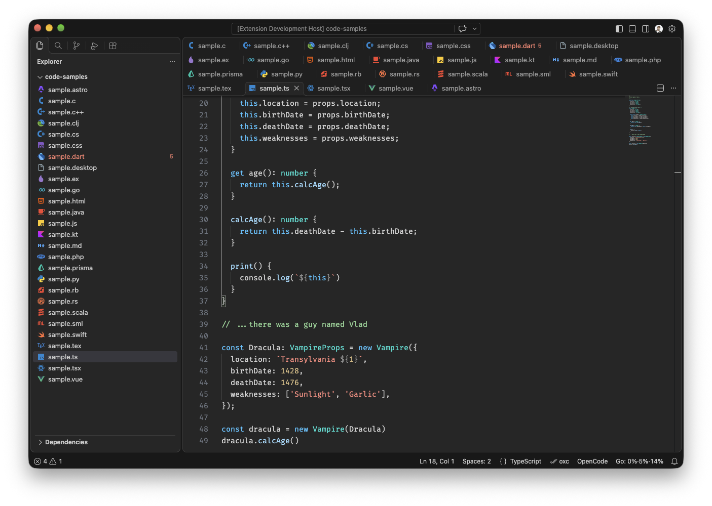

<div align="center">
  

  # Orca Theme

  Yet another dark VSCode theme.

</div>
<br />



## Installation

### From the Marketplace

1. Open the Extensions view (`Ctrl+Shift+X` / `Cmd+Shift+X`)
2. Search for **Orca Theme**
3. Click **Install**

### From a VSIX

```bash
code --install-extension orca-theme-1.0.0.vsix
```

## Activation

1. Open the Command Palette (`Ctrl+Shift+P` / `Cmd+Shift+P`)
2. Run **Preferences: Color Theme**
3. Select **Orca Theme**

## License

[MIT](LICENSE)
